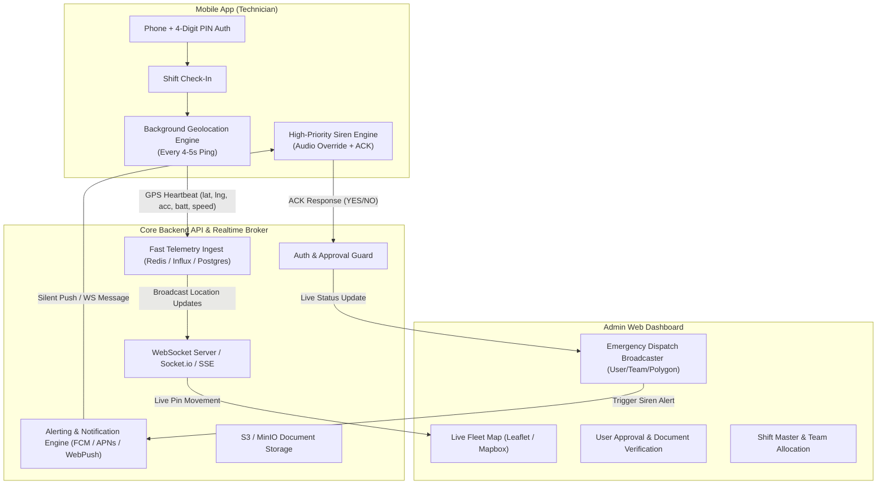
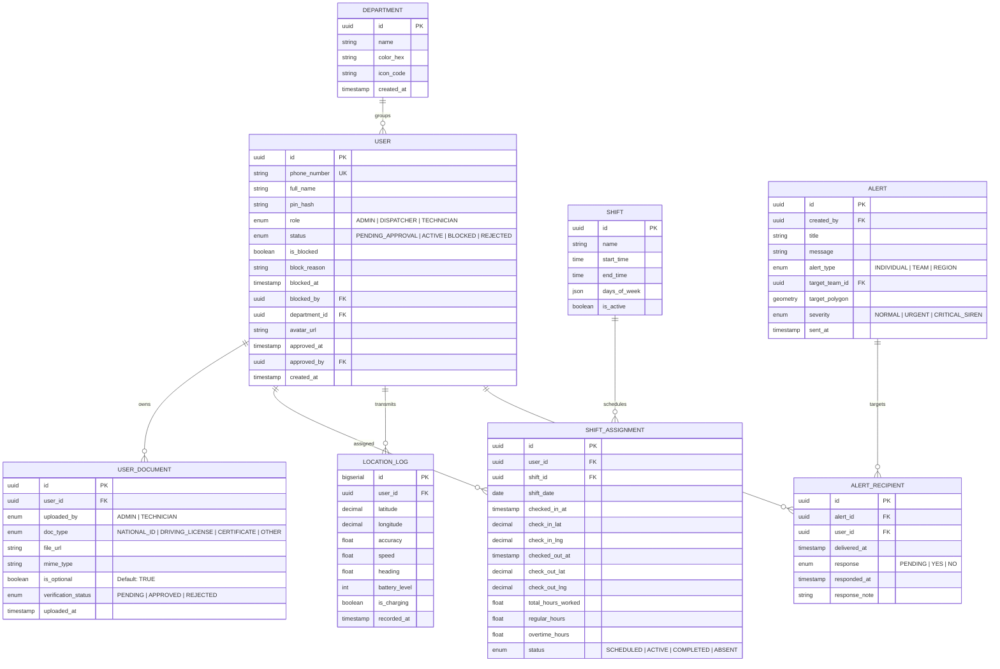

# Technical Specification Document: Manpower Live Tracking & Operations System

**Document Version:** 1.0.0  
**Target Audience:** Senior Full-Stack Engineer, Mobile (React/React Native) Developer, DevOps  
**System Classification:** Real-Time Field Force Telemetry & Operations Command Center  

---

## 1. Executive Summary & Core Objectives

The system is a real-time field workforce monitoring and dispatch management platform. It comprises:
1. **Field Mobile App (React Native / PWA):** Low-friction phone + 4-digit PIN authentication, continuous background GPS telemetry (4–5 second heartbeat), shift check-in/out, and high-priority siren alert reception with binary ACK (`YES` / `NO`).
2. **Dispatcher Admin Web Console (React / Vite):** Live map with color-coded team pins, approval queues for self-registered technicians, shift configuration master, and geo/team alert broadcaster.
3. **Real-Time Backend Service:** Ingestion pipeline capable of processing high-frequency GPS pings (HTTP batching or WebSocket/MQTT), state persistence, S3-compatible document storage, and push notification relays.



---

## 2. System Architecture & Recommended Tech Stack

| Layer | Recommended Technology | Technical Rationale |
| :--- | :--- | :--- |
| **Mobile Client** | **React Native (Bare or Expo Prebuild)** | Requires native background location services (`react-native-background-geolocation` or Expo Background Location task) and audio bypass for the emergency siren. |
| **Admin Web Frontend** | **React (Vite) + Tailwind CSS + shadcn/ui** | Rapid, high-performance dashboard UI. Map rendering via `Mapbox GL JS` or `Leaflet` (`react-map-gl`). |
| **Backend Framework** | **Node.js (NestJS / Fastify) OR Go** | High-throughput async I/O. NestJS provides robust TypeScript contracts, dependency injection, and out-of-the-box WebSocket gateway support. |
| **Primary Relational DB** | **PostgreSQL 15+ with PostGIS extension** | Relational integrity for users, shifts, teams, and native spatial queries (`ST_DWithin`, `ST_Contains` for polygon geo-alerts). |
| **Fast In-Memory / Cache**| **Redis 7 (Pub/Sub & Geospatial)** | Temporary live location caching (`GEOADD`, `GEORADIUS`), active technician session state, and WebSocket pub/sub scaling. |
| **Object Storage** | **AWS S3 / Cloudflare R2 / MinIO** | Storage of user documents (National IDs, certificates, photo verification). |
| **Push Notification** | **Firebase Cloud Messaging (FCM) + APNs** | Critical alert delivery with `apns-priority: 10` and `high_priority` Android channel. |

---

## 3. Data Models & Entity Relationship



---

## 4. Detailed Functional Modules & Workflows

### 4.1 Authentication, Registration & User Access Control
1. **Technician Self-Registration:**
   - Technician enters `phone_number`, `full_name`, and chooses a `4-digit PIN`.
   - Backend hashes the PIN using `bcrypt` (with salt rounds = 10) or `Argon2id`.
   - Account is created in `PENDING_APPROVAL` status.
   - Profile/document upload is strictly **optional** (users can skip and submit immediately).
2. **Admin-Initiated Provisioning & Optional Document Upload:**
   - Admin invites/creates technician via dashboard (specifying name, phone number, and department).
   - Admin can optionally upload documents (PDFs, ID photos) on behalf of the technician, or leave it blank.
   - The technician can also optionally upload/update documents from their mobile profile at any point. Document upload is never a blocking gate.
3. **Admin User Blocking / Ban System:**
   - The Admin console includes an immediate **"Block User / Block Phone Number"** action.
   - **Enforcement Mechanics:**
     - Account status shifts to `BLOCKED` with `is_blocked = true`.
     - Active JWT session tokens are immediately invalidated in Redis (`token:blacklist:{jti}` or `user:revoked_before:{user_id}`).
     - Any active WebSocket telemetry stream is forcefully closed with status code `4403 User Blocked`.
     - Future login attempts with this phone number fail with `403 Forbidden` (`{"error": "ACCOUNT_BLOCKED", "message": "This phone number has been blocked by administration."}`).
     - Admin can unblock the user at any time, restoring login capability.
4. **Approval Queue:**
   - Admin view displays all `PENDING_APPROVAL` technicians.
   - Admin clicks **Approve** or **Reject** (with reason). Document presence is not mandatory for approval.
5. **Day-to-day PIN Login:**
   - Technician enters phone number + 4-digit PIN.
   - System checks: (a) `status == ACTIVE`, (b) `is_blocked == false`.
   - Returns standard Bearer Access Token (expires in 24 hours) + Refresh Token (30 days).

---

### 4.2 High-Frequency Geolocation Telemetry Engine
*Challenge:* Pinging every 4–5 seconds without draining the battery or crashing on mobile OS background killers.

1. **Mobile Background Strategy:**
   - Use Foreground Service with a persistent notification on Android (`"Workforce Active — Location Tracking Active"`).
   - Configure iOS `UIBackgroundModes: ["location"]` with `showsBackgroundLocationIndicator: true`.
   - **Throttling / Batching Logic:**
     - Ping interval: 4 seconds when moving (speed > 1 m/s).
     - When stationary for > 2 minutes, back off ping interval to 15 seconds to conserve battery.
     - Buffer pings locally in SQLite/WatermelonDB if network connectivity drops; flush as a batch once 4G/5G restores.
2. **Payload Specification (`POST /api/v1/telemetry/ping` or WebSocket):**
   ```json
   {
     "userId": "9b1deb4d-3b7d-4bad-9bdd-2b0d7b3dcb6d",
     "shiftId": "e3a89db1-c521-4f1c-9a43-cf85354924c7",
     "latitude": 24.7136,
     "longitude": 46.6753,
     "accuracy": 4.2,
     "speed": 12.5,
     "heading": 182.0,
     "batteryLevel": 78,
     "isCharging": false,
     "recordedAt": "2026-10-18T08:14:22.100Z"
   }
   ```
3. **Real-Time Map Ingestion & Broadcasting:**
   - Backend receives ping $\rightarrow$ updates Redis key `geo:technicians` via `GEOADD` and cache `user:latest_state:{id}` with a 30-second TTL.
   - Publishes to Redis channel `location_updates`.
   - WebSocket gateway pushes the delta only to connected Admin dispatchers looking at the live map viewport.

---

### 4.3 Shift Master & Attendance Tracking
1. **Shift Definition:**
   - Admin defines Shift Templates (e.g., *Shift A: 08:00 - 16:00*, *Shift B: 16:00 - 00:00*).
   - Shifts can have allowed geofence zones or be open-region.
2. **Shift Workflow:**
   - When the technician opens the app, they see their active/upcoming shift.
   - **Shift Login / Check-In Button:** Technician swipes to check in.
   - Telemetry engine starts broadcasting immediately upon check-in.
   - **Shift Checkout:** Technician ends shift; tracking engine stops broadcasting (protects employee privacy during off-hours).

---

### 4.4 Department & Team Visual Grouping
1. **Color Coded Pins:**
   - Each Department has an assigned HEX color (e.g., Plumbing: `#3B82F6` Blue, Electrical: `#EF4444` Red, HVAC: `#10B981` Green).
   - On the Admin Map, markers display:
     - Outer ring colored with the Team Color.
     - Inner icon or avatar of the technician.
     - Pulse indicator: Green (transmitting within 10s), Amber (lagging 10–30s), Grey (offline / disconnected).
2. **Filters on Admin Live Dashboard:**
   - Filter by Department / Team.
   - Filter by Shift status (Active, Offline, Break).
   - Search by technician name or phone number with instant camera snap-to-marker.

---

### 4.5 Emergency Siren & Dispatch Alert System
1. **Targeting Matrix:**
   - **Single User:** Send alert directly to a specific technician ID.
   - **Department/Team:** Broadcast to all active users belonging to `department_id`.
   - **Geographic Region (Polygon):** Admin uses map drawing tool (polygon / circle); PostGIS spatial query selects all active users whose latest coordinates fall within `ST_Contains(polygon, point)`.
2. **Mobile Device Siren Behavior:**
   - Receives high-priority push or active socket event.
   - App triggers custom alarm sound audio loop (e.g., 85–90 dB emergency siren waveform).
   - Uses native audio focus with stream type `STREAM_ALARM` (Android) or `AVAudioSessionCategoryPlayback` (iOS) so it rings even if the device volume toggle is muted.
   - Full-screen modal overlay pops up displaying alert title, location/instructions, and two prominent buttons:
     - **[YES / ACKNOWLEDGE]**
     - **[NO / CANCEL]** (optional short reason prompt)
3. **Dispatcher Response Tracker:**
   - Live table updates on the dispatcher console:
     - Total targeted: $N$
     - Delivered: $X$
     - Responded YES: $Y$ (Green)
     - Responded NO: $Z$ (Red)
     - No Response / Timeout: $W$ (Flashing Grey)

### 4.6 Daily, Weekly & Monthly Timesheet & Hours Reporting System
1. **Core Concept & Telemetry Attribution:**
   - The timesheet aggregates individual daily work sessions based on confirmed **Shift Check-in** and **Shift Check-out** events paired with the live 4–5s telemetry stream.
   - Prevents ghost attendance: Calculates total elapsed shift time, actual active moving time vs stationary/idle time.
2. **Time Periods & Granularity:**
   - **Daily Timesheet:**
     - Granular day view for any selected calendar date.
     - Displays every technician who checked into an active shift that day: Tech Name, Phone, Team, Shift Name, Exact Check-In Time & GPS Location, Exact Check-Out Time & GPS Location, Total Hours Worked (e.g. `8.25 hrs`), Regular Hours (`8.00 hrs`), Overtime Hours (`0.25 hrs`).
     - Flags in-progress shifts (currently checked-in with a live ticking clock).
   - **Weekly Timesheet:**
     - 7-day matrix (Monday through Sunday) for the selected week.
     - Columns for each day (Mon, Tue, Wed, Thu, Fri, Sat, Sun) showing daily hours worked, plus a **Week Total Hours** sum column.
   - **Monthly Timesheet:**
     - Full calendar month aggregation.
     - Summary metrics: Total Days Worked, Total Shift Hours, Overtime Hours, Average Daily Shift Duration.
3. **Export & Download Engine:**
   - Single-click export on any filtered view:
     - **CSV / Excel (.xlsx):** Structured tabular export with pre-formatted decimal hour calculations ready for payroll import.
     - **PDF Printout:** Clean corporate timesheet summary with company branding, department breakdown, and sign-off signature blocks.
   - Filters supported: Department / Team, Individual Technician, Custom Date Range (from/to).

---

## 5. API Contracts (Developer Blueprint)

### 5.1 Authentication, Profile & Access Control
- `POST /api/v1/auth/register` $\rightarrow$ `{ phone, fullName, pin, departmentId? }` (Document upload optional)
- `POST /api/v1/auth/login-pin` $\rightarrow$ `{ phone, pin }` $\rightarrow$ `{ token, refreshToken, user }` (Blocks if `is_blocked == true`)
- `POST /api/v1/users/{id}/documents` $\rightarrow$ `multipart/form-data` (Optional document upload by tech or admin)
- `GET /api/v1/admin/users/pending` $\rightarrow$ List pending approval accounts
- `PATCH /api/v1/admin/users/{id}/approval` $\rightarrow$ `{ status: "ACTIVE" | "REJECTED", reason?: string }`
- `PATCH /api/v1/admin/users/{id}/block` $\rightarrow$ `{ isBlocked: boolean, reason?: string }` (Revokes tokens, kicks WS)

### 5.2 Shifts & Tracking
- `GET /api/v1/shifts/my-shifts` $\rightarrow$ Active and scheduled shifts for logged-in technician
- `POST /api/v1/shifts/check-in` $\rightarrow$ `{ shiftId, initialLocation: { lat, lng } }`
- `POST /api/v1/shifts/check-out` $\rightarrow$ `{ shiftId, finalLocation: { lat, lng } }`
- `POST /api/v1/telemetry/ping` $\rightarrow$ Ingest single or batched location payloads
- `WS /ws/admin/fleet` $\rightarrow$ Real-time WebSocket connection streaming active markers to Admin

### 5.3 Alerting & Siren Dispatch
- `POST /api/v1/alerts/broadcast` $\rightarrow$
  ```json
  {
    "title": "URGENT: Water Main Burst on Sector 4",
    "message": "All available field techs respond immediately.",
    "severity": "CRITICAL_SIREN",
    "targetType": "REGION",
    "polygonCoordinates": [
      [24.710, 46.670],
      [24.720, 46.670],
      [24.720, 46.685],
      [24.710, 46.685]
    ]
  }
  ```
- `POST /api/v1/alerts/{alertId}/respond` $\rightarrow$ `{ response: "YES" | "NO", note?: string }`
- `GET /api/v1/alerts/{alertId}/live-status` $\rightarrow$ Live delivery & ACK metrics

### 5.4 Timesheet & Hours Reporting APIs
- `GET /api/v1/reports/timesheet` $\rightarrow$
  - Query parameters:
    - `period`: `daily` | `weekly` | `monthly` | `custom`
    - `startDate`: `YYYY-MM-DD`
    - `endDate`: `YYYY-MM-DD`
    - `departmentId`: UUID (optional)
    - `userId`: UUID (optional)
    - `format`: `json` (default)
- `GET /api/v1/reports/timesheet/export` $\rightarrow$
  - Query parameters: same as above + `exportType`: `csv` | `xlsx` | `pdf`
  - Returns binary download stream with `Content-Disposition: attachment; filename="timesheet-october-2026.xlsx"`

---

## 6. Non-Functional Requirements & Security Protocols

1. **Security & PIN Storage:**
   - 4-digit PIN must never be stored in plain text.
   - Implement rate limiting on `/login-pin`: max 5 attempts per 15 minutes per phone number to prevent brute-forcing.
   - Account lockout after 5 consecutive failures with admin-reset capability.
2. **Location Privacy Compliance:**
   - Telemetry must automatically stop when the technician checks out of their shift.
   - Clear on-screen banner in the app indicating whether tracking is currently active.
3. **Data Retention & Aggregation:**
   - Raw 4-second location pings kept in hot storage (PostGIS / TimescaleDB) for 30 days.
   - Automated nightly cron job to aggregate raw pings into travel paths (linestrings) and purge minute-by-minute raw records past 30 days.

---

## 7. Developer Implementation & Sprint Matrix (Spreadsheet Format)

*A machine-readable CSV version of this matrix is also available at [`manpower_tracking_dev_matrix.csv`](file:///Users/alitimate/Downloads/Antigravity_codebase/manpower_tracking_dev_matrix.csv).*

| Module ID | Module Name | Feature / User Story | Platform | Technical Acceptance Criteria | API / Schema | Priority | Est. Days | Sprint Phase |
| :--- | :--- | :--- | :--- | :--- | :--- | :---: | :---: | :---: |
| **MOD-01** | User Management | Technician Self-Registration | Mobile App | Sign up with Full Name, Phone, and 4-digit PIN. Creates account in `PENDING_APPROVAL`. Disallows duplicate phone numbers. | `POST /api/v1/auth/register` | **P0** | 2.0 | Phase 1 (Sprint 1) |
| **MOD-02** | User Management | Admin Pre-Provisioning | Admin Console | Admin creates tech account via dashboard with Name, Phone, & assigned Department. | `POST /api/v1/admin/users/create` | **P0** | 1.5 | Phase 1 (Sprint 1) |
| **MOD-03** | User Management | 4-Digit PIN Authentication | Mobile & API | Salted hashing (`bcrypt`/`argon2`). Rate limiting: max 5 attempts per 15 min. Rejects blocked numbers. Returns JWT. | `POST /api/v1/auth/login-pin` | **P0** | 2.0 | Phase 1 (Sprint 1) |
| **MOD-04** | User Management | Optional Document Upload | Mobile & Admin | Optional upload of National ID, Certs (PDF/Image) by Admin or Technician. Non-blocking for registration/approval. | `POST /api/v1/users/{id}/documents` | **P1** | 2.0 | Phase 1 (Sprint 1) |
| **MOD-05** | User Management | Admin Approval Workflow | Admin Console | Admin queue displaying pending users with inline doc previews (if uploaded); Approve or Reject action buttons. | `PATCH /api/v1/admin/users/{id}/approval` | **P0** | 1.5 | Phase 1 (Sprint 1) |
| **MOD-05B** | User Management | User Blocking & Revocation | Admin & API | Admin can block/unblock a phone number. Instantly invalidates JWT, disconnects active WebSocket, and blocks login. | `PATCH /api/v1/admin/users/{id}/block` | **P0** | 1.5 | Phase 1 (Sprint 1) |
| **MOD-06** | Department Master | Department & Color Definition | Admin & DB | CRUD for Departments/Teams with Name, Color Hex (`#3B82F6`), and Icon identifier. | `GET/POST/PUT /api/v1/departments` | **P0** | 1.5 | Phase 1 (Sprint 1) |
| **MOD-07** | Shift Master | Shift Definition Master | Admin Console | Configure shifts (Name, Start/End Time, Days of Week, optional Geofence zone). | `GET/POST/PUT /api/v1/shifts` | **P1** | 2.0 | Phase 2 (Sprint 2) |
| **MOD-08** | Shift Master | Technician Shift Allocation | Admin Console | Assign individual technicians or whole teams to shifts. Weekly roster view. | `POST /api/v1/shifts/assign` | **P1** | 2.0 | Phase 2 (Sprint 2) |
| **MOD-09** | Shift Operations | Shift Check-In & Check-Out | Mobile App | One-tap check-in starts background telemetry. Check-out halts GPS broadcast and logs work hours. | `POST /api/v1/shifts/check-in` / `check-out` | **P0** | 1.5 | Phase 2 (Sprint 2) |
| **MOD-10** | Live Tracking | Mobile Background Telemetry | Mobile App | High-frequency background location service pinging every 4–5s during active shift. Local buffer for offline mode. | Native BG Geolocation / SQLite Buffer | **P0** | 4.0 | Phase 2 (Sprint 2) |
| **MOD-11** | Live Tracking | Telemetry Ingestion Pipeline | Backend & Cache | Ingest 4–5s pings into Redis GEO/TTL cache and PostGIS DB. Emits to WebSocket Pub/Sub. | `POST /api/v1/telemetry/ping`, Redis `GEOADD` | **P0** | 3.0 | Phase 2 (Sprint 2) |
| **MOD-12** | Dispatcher Map | Live Fleet Map View | Admin Console | Interactive map (Mapbox GL/Leaflet) rendering active techs with color-coded team markers and live movement. | `WS /ws/admin/fleet`, `react-map-gl` | **P0** | 4.0 | Phase 3 (Sprint 3) |
| **MOD-13** | Dispatcher Map | Fleet Filtering & Drawer | Admin Console | Filter by Department, Shift, Status. Click pin for quick drawer (battery %, speed, shift timer, call). | Frontend state + Drawer UI | **P1** | 2.0 | Phase 3 (Sprint 3) |
| **MOD-14** | Emergency Alert | Alert Broadcaster Engine | Admin Console | Dispatch alerts to (a) Single User, (b) Whole Department, or (c) Drawn Polygon region. | `POST /api/v1/alerts/broadcast` (PostGIS) | **P0** | 3.0 | Phase 3 (Sprint 3) |
| **MOD-15** | Emergency Alert | Mobile Siren & Alarm Screen | Mobile App | High-decibel audio loop overriding silent mode. Fullscreen overlay with Alert Details & YES/NO buttons. | `react-native-sound` / Audio Focus | **P0** | 3.5 | Phase 4 (Sprint 4) |
| **MOD-16** | Emergency Alert | Two-Way Acknowledgment (ACK) | Mobile & API | Tech responds YES/NO. Stops siren immediately, logs timestamp + coordinates back to server. | `POST /api/v1/alerts/{id}/respond` | **P0** | 2.0 | Phase 4 (Sprint 4) |
| **MOD-17** | Emergency Alert | Dispatcher Live Response Monitor | Admin Console | Live updating grid tracking ACK rates (Total Sent, Delivered, Responded YES, Responded NO, Pending). | `WS /ws/admin/alerts/{id}` | **P1** | 2.0 | Phase 4 (Sprint 4) |
| **MOD-18** | Route Analytics | Historical Route Playback | Admin & DB | Select technician and timeframe to replay historical breadcrumb trail on map with speed/stops graph. | `GET /api/v1/reports/route-history` | **P2** | 3.0 | Phase 4 (Sprint 4) |
| **MOD-19** | Timesheet System | Timesheet Calculation Engine | Backend & DB | Calculates daily hours per worker from check-in/out timestamps and GPS continuity. Aggregates daily, weekly, monthly totals. | `GET /api/v1/reports/timesheet`, SQL aggregation | **P0** | 3.0 | Phase 3 (Sprint 3) |
| **MOD-20** | Timesheet System | Timesheet UI & Multi-Format Exporter | Admin Console | Interactive table with Day/Week/Month tabs. Single-click download to CSV, Excel (.xlsx), and printable PDF. | `GET /api/v1/reports/timesheet/export` | **P0** | 2.5 | Phase 3 (Sprint 3) |


